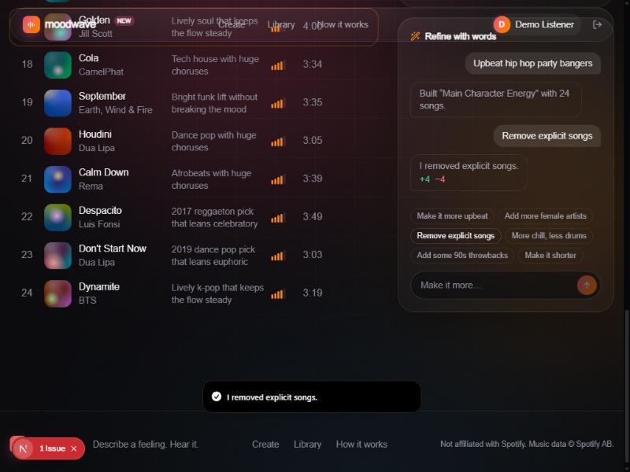
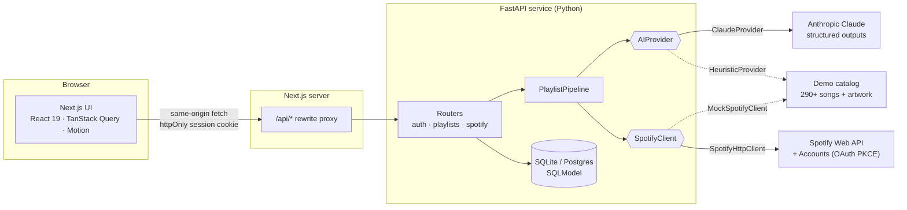
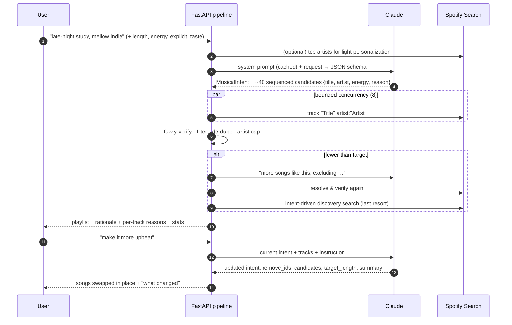

# Moodwave: AI Spotify playlist generator

> **Describe a feeling. Hear it.** Type a mood, moment or vibe in plain language. Moodwave's AI curator interprets it, builds a playlist of **real, verified Spotify tracks**, explains why the playlist fits, and lets you reshape it through conversation ("make it more upbeat", "add more female artists", "remove explicit songs").


| Playlist | Conversational refinement | Mobile |
| --- | --- | --- |
|  |  |  |

| Library | How it works | Composing |
| --- | --- | --- |
|  |  |  |

**Stack:** Next.js 15 · React 19 · TypeScript · Tailwind CSS v4 · Motion · TanStack Query · Radix · **Python 3.12 · FastAPI · SQLModel** · Anthropic Claude · Spotify Web API · Docker · GitHub Actions

---

## Table of contents

1. [Features](#features)
1. [Design: "Nocturne"](#design-nocturne)
2. [Quick start (demo mode, no keys needed)](#quick-start-demo-mode-no-keys-needed)
3. [Connecting Spotify and Claude](#connecting-spotify-and-claude)
4. [Environment variables](#environment-variables)
5. [Architecture](#architecture)
6. [The AI recommendation workflow](#the-ai-recommendation-workflow)
7. [Spotify API integration](#spotify-api-integration)
8. [API reference](#api-reference)
9. [Project structure](#project-structure)
10. [Testing and quality](#testing-and-quality)
11. [Security, accessibility and performance](#security-accessibility-and-performance)
12. [Design decisions and trade-offs](#design-decisions-and-trade-offs)
13. [Roadmap](#roadmap)

---

## Features

**AI-first experience**
- A large natural-language prompt is the centerpiece, with animated example prompts, suggestion chips and tuning controls (length 15–30, energy dial, explicit filter, "blend in my taste").
- A **"Why this fits"** panel shows the model's structured interpretation: a written rationale, energy and mood meters, tempo range, vocals, era, mood/genre chips, sonic characteristics and an animated **energy-arc** chart of the sequence.
- Every track carries a short AI-written **reason** for being in the playlist.
- **Conversational refinement:** follow-up instructions update the intent, remove songs that no longer fit, slot new ones into the same positions and summarize what changed (`+4 −4`). New songs are highlighted.
- **Mood-reactive UI:** each playlist re-tints the app (aurora background, buttons, accents) from its energy and valence.

**Playlist editor**
- Drag-and-drop reordering (mouse, touch and **keyboard**) with optimistic updates.
- Remove with **undo**, **replace one song** with an AI-picked alternative, add any song via Spotify search, and rename inline.
- Regenerate from the original prompt, save to Spotify (private playlist) and delete.
- A docked player uses the official Spotify embed, with a simulated player for demo tracks.

**Product polish**
- Landing, Studio (generator), Results/Editor, Library (with filters plus your Spotify playlists) and How-it-works pages.
- Skeleton screens, empty states, error states with retry, auth gates, toasts, a staged generation progress screen, rate-limit messages and an "only N songs found" notice.
- Responsive from 360px phones (bottom-sheet refine bar) to wide desktops.
- **Demo mode:** with no credentials, a curated catalog of 290+ real songs (with real artwork and artist portraits) and an offline heuristic curator keep every feature working.

## Design: "Nocturne"

The interface is built to feel like a music product first and an AI product second.

- **Typography:** oversized **Fraunces** (soft, optical-sized serif with italic accents) for headlines, **Inter Tight** for interface text, and **JetBrains Mono** for small uppercase metadata ("24 SONGS · 1 HR 32 MIN").
- **Palette:** a warm near-black with three surface levels, warm off-white text, and one restrained lilac accent used only for focus, active states and the primary action. Each playlist tints a dim atmosphere from its mood (energy and valence), plus a dissolved, blurred version of its lead record.
- **Real artists as the imagery:** real album covers and artist photography carry the visual identity. Portraits get a consistent editorial monochrome treatment that blooms to colour on hover, so mismatched press photos read as one system. There are no stock illustrations.
- **Surfaces:** mostly solid cards with hairline borders and long soft shadows. Translucent "chrome" is reserved for the floating nav, the composers and the player.
- **Motion:** one easing curve throughout, page transitions, scroll reveals, a focus halo on the composer, floating mood cards, a "records settling into place" generation screen, rows that animate in place on refine, and a pipeline line that draws on scroll. `prefers-reduced-motion` is respected everywhere.

**Key surfaces**

- **Hero:** "What are you *in the mood* for?" with the composer at the centre. Five mood cards ("Late-night drive through Toronto", "Coding at 2 AM", and others) orbit it, each cast with real artists. Behind it is a slow wall of artist portraits, and hovering a mood lights up its artists.
- **Playlist:** a 6-cover collage with pointer tilt, the AI title set very large, and liner-notes metadata (songs, duration, mood, energy, genres). A **Featuring** strip of artist portraits spotlights an artist's songs, the **Liner notes** show the curator's reasoning as a pull-quote with the energy arc, and the tracklist has a cover and an AI reason on every row.
- **"Make it more…":** a floating refinement composer with suggestions (Energetic, Chill, Nostalgic, More indie, Less mainstream, More female artists, No explicit songs). Free text works too ("more upbeat but keep the same artists"), and a session history sits behind a popover.
- **Library:** a masonry collection of collage cards. **How it works:** four animated stages (Your words → AI understands the vibe → Music discovery → Personalized playlist).

### Demo artwork

`apps/api/scripts/fetch_artwork.py` fetches real album covers and artist portraits for the demo catalog once, from Deezer's and Apple's keyless public APIs, and commits them as `app/data/artwork.json` and `app/data/artist_images.json`. The app never calls those services at runtime. Every hit is verified with the same fuzzy matcher the pipeline uses. The script prefers the song's original album over compilations, falls back to an album search, and prefers the most-followed artist when names collide. Portraits that are placeholders or logos rather than the artist are excluded by hand (`REJECTED_PORTRAITS`). Coverage is 291/293 covers and 186/191 portraits. Live Spotify mode uses Spotify's own artwork and artist images (one batched `/v1/artists` call per playlist).

```bash
cd apps/api && python -m scripts.fetch_artwork   # resumable; keeps existing entries
```

## Quick start (demo mode, no keys needed)

**Prerequisites:** Node.js 20+ and Python 3.12+.

```bash
# 1) API (terminal 1)
cd apps/api
python -m venv .venv
# Windows: .venv\Scripts\activate    macOS/Linux: source .venv/bin/activate
pip install -r requirements-dev.txt
cp .env.example .env            # optional in demo mode
uvicorn app.main:app --reload --port 8000

# 2) Web (terminal 2)
cd apps/web
npm install
npm run dev                     # http://127.0.0.1:3000
```

Open **http://127.0.0.1:3000** and click **Try the demo**, or just type a prompt and press Enter.

**Docker alternative:**

```bash
docker compose up --build       # http://127.0.0.1:3000
```

## Connecting Spotify and Claude

Both integrations are optional and independent. Add keys to `apps/api/.env` and restart the API.

### Spotify
1. Create an app at <https://developer.spotify.com/dashboard> and select **Web API**.
2. Add the redirect URI **`http://127.0.0.1:3000/api/auth/callback`** exactly. Spotify requires loopback IPs; `localhost` is not allowed.
3. Copy the Client ID and Client Secret into `SPOTIFY_CLIENT_ID` and `SPOTIFY_CLIENT_SECRET`.
4. New apps run in **development mode**, so add your Spotify account (and any demo viewers) under *User Management*. Unlisted users get a friendly "not allow-listed" message.

### Anthropic (Claude)
1. Create a key at <https://console.anthropic.com>.
2. Set `ANTHROPIC_API_KEY`. The model defaults to `claude-sonnet-5-5` and can be changed with `ANTHROPIC_MODEL`.

The UI always shows which integrations are live (demo banner, plus a "Claude" or "Offline curator" badge on every playlist).

## Environment variables

**`apps/api/.env`**. Secrets live only here and are never sent to the browser.

| Variable | Default | Description |
| --- | --- | --- |
| `SESSION_SECRET` | dev placeholder | **Required in production.** Signs session cookies and derives the Fernet key that encrypts Spotify tokens at rest. |
| `ENVIRONMENT` | `development` | `production` enables `Secure` cookies. |
| `FRONTEND_URL` | `http://127.0.0.1:3000` | Used for OAuth redirects and CORS. |
| `DATABASE_URL` | `sqlite:///apps/api/moodwave.db` | Any SQLAlchemy URL (for example Postgres). |
| `SPOTIFY_CLIENT_ID` / `SPOTIFY_CLIENT_SECRET` | – | Enables real Spotify. Leave blank for demo mode. |
| `SPOTIFY_REDIRECT_URI` | `http://127.0.0.1:3000/api/auth/callback` | Must match the Spotify dashboard. |
| `SPOTIFY_MARKET` | `US` | Market used for search availability. |
| `ANTHROPIC_API_KEY` | – | Enables Claude. Leave blank for the heuristic curator. |
| `ANTHROPIC_MODEL` | `claude-sonnet-5-5` | Model id. |
| `ANTHROPIC_EFFORT` | `medium` | Effort for the initial plan (refinements use `low` for speed). |
| `ANTHROPIC_ENABLE_FALLBACKS` | `true` | Server-side refusal fallback (`fallbacks: "default"`). |
| `GENERATE_RATE_LIMIT_PER_MINUTE` | `8` | Per-user generation/refine limit. |

**`apps/web/.env.local`**

| Variable | Default | Description |
| --- | --- | --- |
| `API_URL` | `http://127.0.0.1:8000` | Where Next.js proxies `/api/*`. Server-side only. |

## Architecture



- **Service layer behind interfaces.** Routers depend on the `AIProvider` and `SpotifyClient` protocols, not concrete classes. FastAPI dependencies pick the implementation (Claude or heuristic, real or mock) from configuration, so the pipeline code is identical in demo and production, and tests inject fakes.
- **Same-origin by design.** The browser never calls Spotify or Anthropic, and never sees a token. Next.js rewrites `/api/*` to FastAPI, so the session cookie is first-party.
- **Persistence.** `User`, `SpotifyToken` (encrypted), `Playlist` (intent stored as JSON), `PlaylistTrack` (ordered) and `RefinementTurn` (conversation history).

## The AI recommendation workflow



1. **Interpret.** `ClaudeProvider` calls the Messages API with **structured outputs** (`output_config.format` with a JSON schema), so the response is guaranteed to be valid JSON. It's validated into a Pydantic `MusicalIntent`: title, description, moods, genres, sonic characteristics, energy and valence (0–1), tempo range, era, vocal preference, explicit policy, reference artists and a listener-facing **rationale**. Alongside it come about `target + 14` sequenced candidates. The static system prompt is marked for **prompt caching**. Refusals, truncation and API errors become a typed `AIError`.
2. **Resolve.** Each candidate is looked up with a field-filtered Spotify search (`track:"…" artist:"…"`), falling back to a looser query for remasters and alternate titles. Lookups run concurrently under a semaphore and honor `429 Retry-After`.
3. **Verify.** RapidFuzz compares the normalized title and artist (stripping "– Remastered", "(feat. …)", punctuation). Hits below the thresholds (title ≥ 85, artist ≥ 80) are discarded. **This is the hallucination guard:** a song the model invents simply never makes it into the playlist (see `test_hallucinated_songs_are_dropped_and_backfilled`).
4. **Filter and sequence.** Explicit policy, a 1–12 minute duration bound, de-duplication by id and by normalized `(title, artist)`, and at most two songs per artist (four for single-artist requests). The model's listening order is preserved.
5. **Backfill.** If too few tracks survive, Claude is asked for more songs that exclude what's already used. If that still isn't enough, an intent-driven discovery search (genres and reference artists) fills the remaining slots.
6. **Refine.** The current intent, track list (ids, explicit flags, energy) and instruction go back to Claude, which returns an updated intent and rationale, `remove_track_ids`, new candidates, a `target_length` and a summary. New verified songs replace the removed songs **in place**, so the energy arc keeps its shape. Each turn is persisted as conversation history.
7. **Replace one.** The same flow scoped to one slot: alternatives with a similar energy and role in the sequence.
8. **Graceful degradation.** If Claude errors, refuses or is rate-limited, the pipeline transparently falls back to the **heuristic curator** (keyword lexicon → the same `MusicalIntent` shape → feature-scored catalog picks with arc sequencing) and the UI shows a notice.

## Spotify API integration

| Capability | Endpoint(s) |
| --- | --- |
| Sign-in | Authorization Code **with PKCE**, `accounts.spotify.com/authorize` and `/api/token` |
| Profile | `GET /v1/me` |
| Personalization | `GET /v1/me/top/artists` |
| Resolve and search tracks | `GET /v1/search?type=track` |
| Save playlist | `POST /v1/me/playlists`, then add items in batches of 100 (falls back to the legacy `/users/{id}/playlists` and `/tracks` routes) |
| Library | `GET /v1/me/playlists` |
| Playback | Official embed `open.spotify.com/embed/track/{id}` |

**Platform constraint.** Since November 2024, new Spotify apps can't use `/recommendations`, `/audio-features`, `/artists/{id}/related-artists`, or `preview_url`. Moodwave is designed around that: the LLM supplies musical judgment (including per-track energy estimates), Spotify search supplies ground truth, and playback uses the embed (full tracks for logged-in Premium users, previews otherwise).

Scopes requested: `user-read-private user-read-email user-top-read playlist-read-private playlist-modify-private playlist-modify-public`.

## API reference

Interactive docs are available at **http://127.0.0.1:8000/docs** (OpenAPI).

| Method | Path | Description |
| --- | --- | --- |
| `GET` | `/auth/config` | Which integrations are live (demo, Spotify, AI model) |
| `GET` | `/auth/me` | Current user or `null` |
| `GET` | `/auth/login` → `/auth/callback` | Spotify OAuth (PKCE) |
| `POST` | `/auth/demo` | Start a demo session |
| `POST` | `/auth/logout` | Clear the session |
| `POST` | `/playlists/generate` | Prompt → playlist (rate-limited) |
| `GET` | `/playlists` | Library summaries |
| `GET` / `PATCH` / `DELETE` | `/playlists/{id}` | Read, rename, delete |
| `PUT` | `/playlists/{id}/tracks` | Persist reorder/remove/add (full ordered list) |
| `POST` | `/playlists/{id}/refine` | Natural-language refinement |
| `POST` | `/playlists/{id}/regenerate` | Fresh take on the original prompt |
| `POST` | `/playlists/{id}/tracks/{trackId}/replace` | Swap one song for an AI-picked alternative |
| `POST` | `/playlists/{id}/save` | Create the playlist on Spotify |
| `GET` | `/spotify/search?q=` | Track search for manual adds |
| `GET` | `/spotify/playlists` | The user's Spotify playlists |
| `GET` | `/catalog/featured` | Public showcase data: featured tracks and artists with artwork and portraits |

## Project structure

```
moodwave/
├─ apps/
│  ├─ api/                        FastAPI service (Python)
│  │  ├─ app/
│  │  │  ├─ core/                 settings, sessions, PKCE, token encryption
│  │  │  ├─ data/catalog.py       demo catalog (290+ real songs + features), artwork.json, artist_images.json
│  │  │  ├─ routers/              auth · playlists · spotify
│  │  │  ├─ services/
│  │  │  │  ├─ ai/                AIProvider protocol, Claude + heuristic, prompts & schemas
│  │  │  │  ├─ spotify/           SpotifyClient protocol, HTTP + mock clients, OAuth
│  │  │  │  └─ pipeline.py        interpret → resolve → verify → filter → backfill → refine
│  │  │  ├─ deps.py               DI, auth, rate limiting
│  │  │  ├─ models.py             SQLModel tables
│  │  │  └─ schemas.py            Pydantic I/O (mirrored in web/lib/types.ts)
│  │  └─ tests/                   pytest: pipeline + end-to-end API
│  └─ web/                        Next.js 15 app (TypeScript)
│     ├─ app/                     routes: / · /generate · /playlist/[id] · /library · /about
│     ├─ components/
│     │  ├─ prompt/               PromptComposer, GenerationOverlay, SuggestionChips
│     │  ├─ playlist/             Hero, TrackList (dnd), IntentPanel, EnergyCurve, RefineDock, PlayerDock, AddSongDialog
│     │  ├─ layout/ · art/ · ui/  nav, auth dialog, covers, design-system primitives
│     └─ lib/                     typed API client + query hooks, mood colors, stores
├─ docker-compose.yml
└─ .github/workflows/ci.yml       lint, format, types, tests, build
```

## Testing and quality

```bash
cd apps/api && pytest -q                 # 23 tests: matching, filters, intent parsing, refine,
                                         # replace, AI fallback, hallucination guard, full API lifecycle
ruff check app tests && ruff format --check app tests

cd apps/web && npm run lint && npm run typecheck && npm run build
```

CI runs all of the above on every push and pull request.

## Security, accessibility and performance

**Security**
- OAuth runs entirely server-side with **PKCE** and a signed, short-lived `state` cookie (CSRF protection).
- Spotify tokens are **Fernet-encrypted at rest** and refreshed automatically before expiry.
- Sessions use a signed **httpOnly, SameSite=Lax** cookie (`Secure` in production). No tokens or keys reach the browser.
- Ownership checks on every playlist route. Pydantic validation and length limits on all input.
- The user prompt is wrapped in delimiters inside the model input and is never executed. The model output is schema-constrained and validated.
- Per-user rate limiting on AI routes.

**Accessibility**
- Semantic landmarks, a skip link, labelled controls and dialogs (Radix), visible focus rings.
- Keyboard drag-and-drop reordering (Space, then arrow keys), `aria-live` progress and refinement updates, meters and charts with text alternatives.
- `prefers-reduced-motion` is respected globally (CSS and Motion).

**Performance**
- Concurrent Spotify resolution with bounded parallelism, plus prompt caching on the static system prompt.
- Optimistic UI for edits, a cached query layer, and lazy, size-hinted artwork via `next/image`.
- Static prerendering for marketing pages. Generated covers are pure CSS, with no image requests in demo mode.

## Design decisions and trade-offs

- **LLM names songs, Spotify proves them.** This is robust to Spotify's deprecations, and the fuzzy verifier makes hallucinations a non-issue for the user.
- **One request with staged progress UI** rather than streaming. It's simpler and works through any proxy. SSE streaming of pipeline stages is a natural next step.
- **Structured outputs over free-text parsing.** The schema is the contract between the model and the code, and Pydantic enforces ranges the schema subset can't express.
- **Heuristic fallback that shares the contract.** The product never hard-fails on an AI outage, and the whole app is demoable offline.
- **SQLite + SQLModel** keeps setup to zero; swapping `DATABASE_URL` moves to Postgres.
- **Mood-derived theming instead of artwork color extraction.** It's deterministic, needs no canvas or CORS, and it expresses the playlist's *feeling*, which is the product's core idea.

## Roadmap

- Stream pipeline stages over SSE, and stream tracks into the list as they resolve.
- Sync edits back to an already-saved Spotify playlist (replace items) instead of saving a new copy.
- Shareable public playlist pages with OG images.
- Redis-backed rate limiting and caching of search results.
- An eval set for prompt quality (intent accuracy, verification hit-rate, diversity).

---

*Not affiliated with Spotify or Anthropic. Spotify is a trademark of Spotify AB.*
