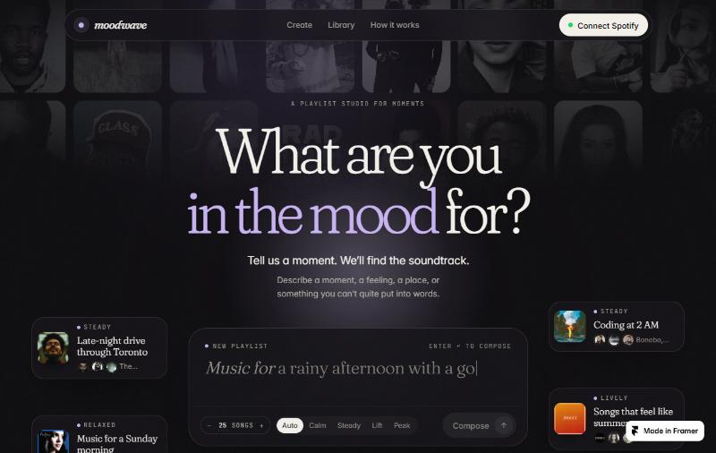
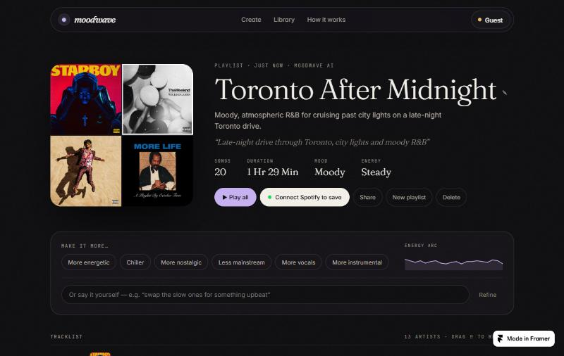
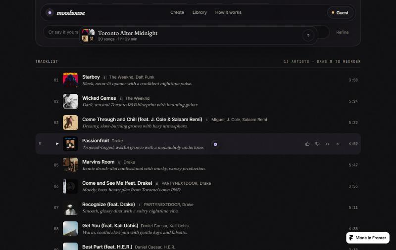
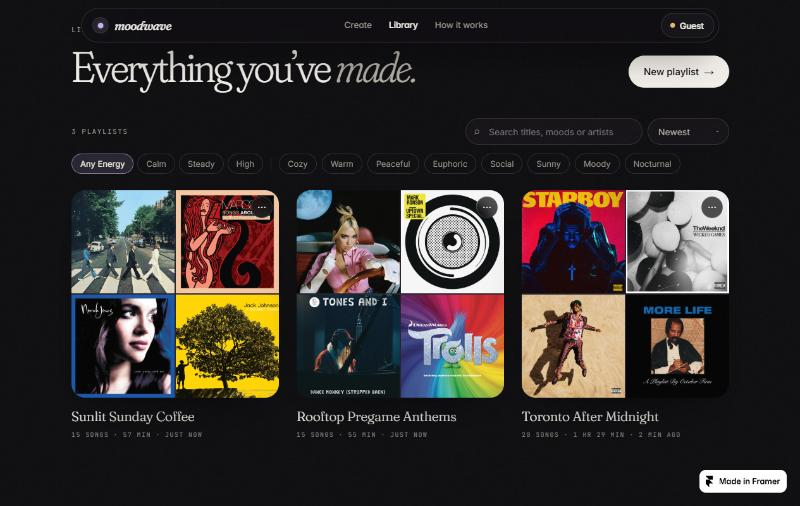
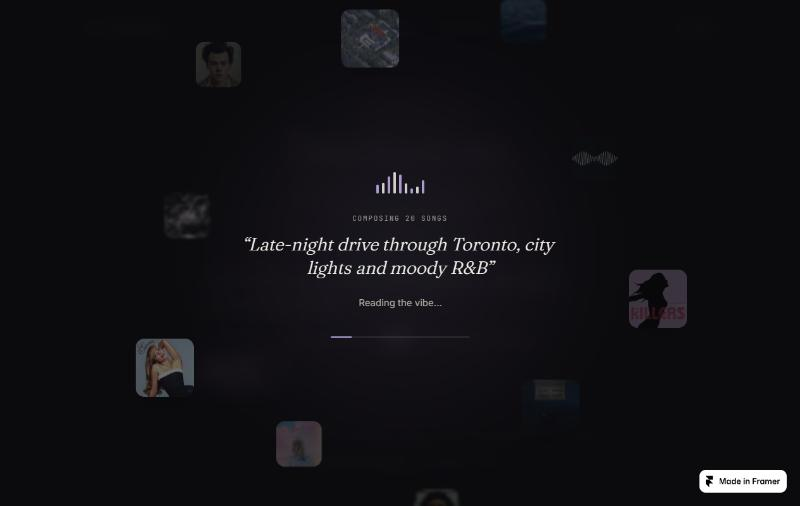
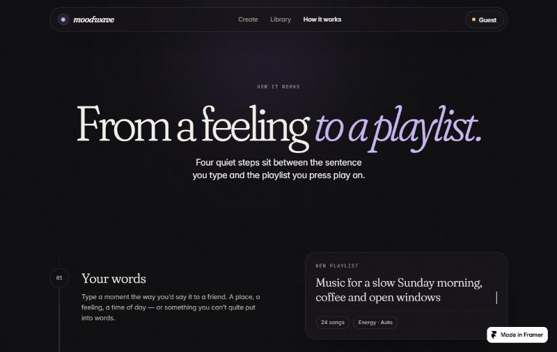
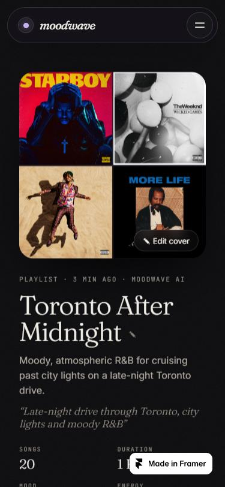
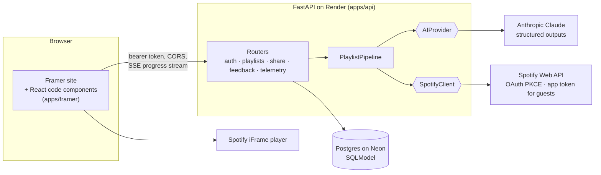
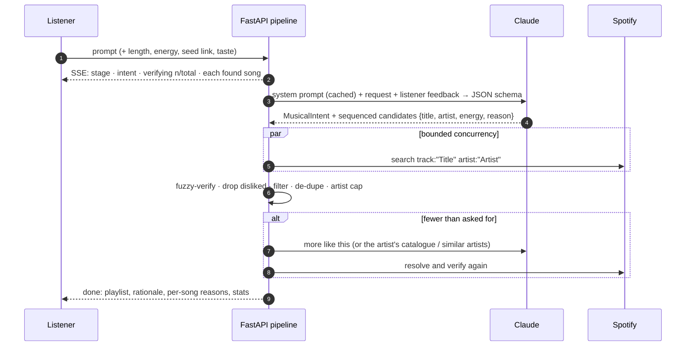

# Moodwave: playlists from a feeling

> **Describe a moment. Hear it.** Type a mood, a place or a feeling in plain words, and Moodwave's AI plans a playlist, finds **real songs on Spotify** (every pick is verified, none are made up), explains why each one fits, and lets you reshape it, share it and save it to Spotify.

**▶ Live: [welcome-pattern-009301.framer.app](https://welcome-pattern-009301.framer.app)**. No account needed: choose **Try it as a guest**.



| A playlist | Every song, with a reason | Your library |
| --- | --- | --- |
|  |  |  |

| Live generation | How it works | Phone |
| --- | --- | --- |
|  |  |  |

**Stack:** Framer (site and React code components) · **Python 3.12 · FastAPI · SQLModel** · Postgres (Neon) · Render · Anthropic Claude · Spotify Web API · GitHub Actions

---

## Contents

1. [What it does](#what-it-does)
2. [Architecture](#architecture)
3. [The AI workflow](#the-ai-workflow)
4. [Spotify integration](#spotify-integration)
5. [Guests, sign-in and privacy](#guests-sign-in-and-privacy)
6. [Running it locally](#running-it-locally)
7. [Configuration](#configuration)
8. [API reference](#api-reference)
9. [Project structure](#project-structure)
10. [Testing and quality](#testing-and-quality)
11. [Design decisions](#design-decisions)
12. [License](#license)

---

## What it does

**Make**
- Describe anything (“late-night drive through Toronto, moody R&B”) and get 15–100 songs. Live progress shows the real steps: reading the mood, checking every song on Spotify, finding more if needed.
- **Start from a song or playlist:** paste a Spotify link to match its sound.
- **Artist-only requests** (“Don Toliver night songs”) stay with that artist and their features, and top up with clearly tagged similar artists if they run out.
- **“For right now”** suggestions based on the time of day and, if you opt in, your local weather. **Recently** brings back your last prompts.

**Shape**
- Refine in plain words (“make it more upbeat”), or drag to reorder, swap, remove with undo, and rename.
- 👍 / 👎 on songs steers future playlists. **Blend my taste** lightly mixes in your top Spotify artists.
- Edit the cover: a grid of four, one song's artwork, or upload your own image.

**Listen and share**
- One shared Spotify player for the whole site, with **Play all**, next and previous, and auto-advance.
- **Save to Spotify** with a custom cover, and **Update on Spotify** after you edit.
- **Share links** show a rich preview (cover and title) in chat apps and open a read-only page anyone can play.

**Around it**
- A library with search across titles, moods, artists and genres, energy and mood filters, sorting, and duplicate, rename and delete.
- Guest mode, an invite-only notice for Spotify's development mode, self-serve **Delete my account and data**, and FAQ, Privacy and Terms pages.
- Accessibility: keyboard paths and visible focus rings throughout, focus-trapped dialogs, reduced-motion support, and 4.5:1 text contrast.
- Music-flavoured interactions: a spinning-vinyl cursor, an energy mixer, a spin-the-record mood picker, and waveform dividers.

## Architecture



- **Framer front end.** Pages, layout and content (including the artist tickers in the Framer CMS) are built in Framer. Everything interactive is a typed React code component, mirrored in [`apps/framer/`](apps/framer) with notes in its [README](apps/framer/README.md). `MoodwaveAPI.tsx` holds the API client, session store, shared player, error reporting and accessibility helpers.
- **API.** Routers depend on the `AIProvider` and `SpotifyClient` protocols. FastAPI dependencies choose Claude or the offline curator, and a user's Spotify session, the app's own Spotify token for guests, or the bundled demo catalogue for tests.
- **Sessions.** The Framer site uses a signed bearer token (Spotify sign-in returns through a one-time hand-off code). Spotify tokens are Fernet-encrypted at rest. Keys and tokens never reach the browser.
- **Ops.** CI runs tests, lint and builds on every push. Render deploys `main`. An uptime monitor keeps the free instance awake. Crashes from the site and the API go to a private error log (`/errors`, owner only).

## The AI workflow



1. **Interpret.** Claude returns a validated `MusicalIntent` (moods, genres, energy, valence, tempo, era, focus artists, rationale) and ordered candidates through **structured outputs**. The static system prompt uses **prompt caching**. Your 👍 / 👎 history is passed in per request.
2. **Verify.** Each candidate is searched on Spotify and fuzzy-matched on normalized title and artist (RapidFuzz). Songs that don't match are dropped, so **the AI can't invent a song**.
3. **Filter and sequence.** Explicit policy, de-duplication, a per-artist cap, removing songs you've disliked (and artists disliked twice), keeping the model's listening order.
4. **Backfill.** Asks for more when short. Artist-only requests pull from that artist's real catalogue, then from tagged similar artists.
5. **Refine, swap and stream.** Refinements replace songs in place so the energy arc keeps its shape. Progress streams to the site as Server-Sent Events, with a normal request as the fallback.
6. **Never hard-fail.** If Claude errors or the guest AI budget runs out, a keyword-driven **offline curator** with the same contract takes over, and the playlist says so.

## Spotify integration

| Capability | How |
| --- | --- |
| Sign-in | Authorization Code **with PKCE** |
| Guests | Client-credentials app token (catalogue search only) |
| Search and verify | `GET /v1/search` (10 results per page in development mode) |
| Start from a link | `GET /v1/tracks/{id}`, playlist items |
| Save and update | Create playlist, add or replace items in batches of 100, `PUT /playlists/{id}/images` for the cover |
| Taste | `GET /v1/me/top/artists` (opt-in) |
| Playback | Spotify iFrame API (full tracks when logged in to Spotify, previews otherwise) |

New Spotify apps can't use `/recommendations`, `/audio-features` or related artists, so the LLM supplies the musical judgment and Spotify supplies the ground truth.

## Guests, sign-in and privacy

- **Spotify development mode** only lets allow-listed accounts sign in (up to 25). Everyone else sees an invite-only notice and can **try it as a guest**: real catalogue and AI, 5 playlists a day of up to 30 songs, and a shared daily AI budget. Guests can't save to Spotify, and guest data expires after 30 days. If an allow-listed guest signs in, their guest playlists move to their account.
- **Your data:** see the live [Privacy](https://welcome-pattern-009301.framer.app/privacy) and [Terms](https://welcome-pattern-009301.framer.app/terms) pages. Accounts can be deleted in one click (`DELETE /auth/me`).

## Running it locally

**Prerequisites:** Python 3.12+ (and Node.js 20+ for the optional Next.js app).

```bash
cd apps/api
python -m venv .venv
# Windows: .venv\Scripts\activate    macOS/Linux: source .venv/bin/activate
pip install -r requirements-dev.txt
cp .env.example .env              # works with no keys: demo catalogue + offline curator
uvicorn app.main:app --reload --port 8000    # docs at http://127.0.0.1:8000/docs
```

Add `SPOTIFY_CLIENT_ID`/`SPOTIFY_CLIENT_SECRET` (redirect URI `http://127.0.0.1:8000/auth/callback` or your deployed `/auth/callback`) and `ANTHROPIC_API_KEY` to use the real services.

The Framer site points at `API_URL` in `apps/framer/MoodwaveAPI.tsx`. `apps/web` is the earlier **Next.js** front end, kept for reference (`npm install && npm run dev`, or `docker compose up --build`).

## Configuration

Environment variables for `apps/api` (in production they're set in the Render dashboard, never committed):

| Variable | Default | Purpose |
| --- | --- | --- |
| `ENVIRONMENT` | `development` | `production` turns on secure cookies and production fallbacks |
| `SESSION_SECRET` | dev placeholder | **Required in production.** Signs sessions, derives the token-encryption key |
| `DATABASE_URL` | local SQLite | Any SQLAlchemy URL (`postgres://` is converted for psycopg) |
| `FRONTEND_URL` / `EXTRA_ORIGINS` | localhost / – | Sites allowed to call the API and receive sign-ins |
| `SHARE_PAGE_URL` | live `/p` page | Where share links forward to |
| `PUBLIC_API_URL` | from the request | Public API address used in share previews |
| `SPOTIFY_CLIENT_ID` / `SPOTIFY_CLIENT_SECRET` / `SPOTIFY_REDIRECT_URI` | – | Real Spotify (blank = demo catalogue) |
| `ANTHROPIC_API_KEY` / `ANTHROPIC_MODEL` | – / `claude-sonnet-5-5` | Real AI (blank = offline curator) |
| `ALLOW_DEMO` | `true` | Anonymous demo sessions (off in production) |
| `ALLOW_GUEST` | `true` | Guest mode |
| `GUEST_PLAYLISTS_PER_DAY` / `GUEST_MAX_TRACKS` / `GUEST_AI_PER_DAY` | 5 / 30 / 40 | Guest limits |
| `GUEST_RETENTION_DAYS` | 30 | How long guest data is kept |
| `OWNER_SPOTIFY_IDS` | first account | Who can read the error log |
| `GENERATE_RATE_LIMIT_PER_MINUTE` | 8 | Per-user AI rate limit |

## API reference

Interactive docs: `/docs` on the API. Highlights:

| Method | Path | Description |
| --- | --- | --- |
| `GET` | `/auth/config` · `/auth/me` | Live integrations and limits · current user |
| `GET` | `/auth/login` → `/auth/callback` | Spotify sign-in (PKCE), returning to the site with a hand-off code |
| `POST` | `/auth/exchange` · `/auth/guest/token` | Hand-off code → session (moves guest playlists) · start a guest session |
| `DELETE` | `/auth/me` | Delete the account and all its data |
| `POST` | `/playlists/generate` · `/playlists/generate/stream` | Prompt → playlist (plain or Server-Sent Events) |
| `GET` / `PATCH` / `DELETE` | `/playlists/{id}` | Read, rename, delete |
| `PUT` | `/playlists/{id}/tracks` | Reorder, remove (full ordered list) |
| `POST` | `/playlists/{id}/refine` · `/tracks/{tid}/replace` | Plain-language refinement · swap one song |
| `PUT` | `/playlists/{id}/cover` · `/cover/image` | Choose a cover · upload one |
| `POST` | `/playlists/{id}/save` · `/sync` | Save to Spotify · update the saved copy |
| `POST` / `DELETE` | `/playlists/{id}/share` | Turn a public link on or off |
| `POST` | `/playlists/{id}/duplicate` | Private copy |
| `GET` | `/share/{slug}` · `/s/{slug}` | Shared playlist JSON · preview page for chat apps |
| `POST` / `GET` | `/feedback` | 👍 / 👎 on songs |
| `POST` / `GET` | `/telemetry/error` · `/telemetry/errors` | Report a crash · owner-only error log |

## Project structure

```
moodwave/
├─ apps/
│  ├─ api/                     FastAPI service (Render)
│  │  ├─ app/
│  │  │  ├─ core/              settings, sessions, PKCE, token encryption
│  │  │  ├─ routers/           auth · playlists · share · feedback · telemetry · spotify · catalog
│  │  │  ├─ services/
│  │  │  │  ├─ ai/             AIProvider protocol, Claude + offline curator, prompts
│  │  │  │  ├─ spotify/        SpotifyClient protocol, HTTP + demo clients, OAuth
│  │  │  │  ├─ pipeline.py     interpret → verify → filter → backfill → refine (+ SSE progress)
│  │  │  │  ├─ guest.py        guest limits, app token, expiry
│  │  │  │  ├─ cover.py        cover art (Pillow) · seed.py (start from a link)
│  │  │  │  └─ accounts.py     account deletion
│  │  │  └─ models.py / schemas.py
│  │  └─ tests/                pytest (77 tests)
│  ├─ framer/                  Framer code components (mirror) + README
│  └─ web/                     earlier Next.js front end (reference)
├─ render.yaml                 Render blueprint
└─ .github/workflows/ci.yml    lint, format, types, tests, build
```

## Testing and quality

```bash
cd apps/api && pytest -q        # matching, filters, focus artists, refine, replace, AI fallback,
                                # hallucination guard, streaming, guests, covers, sharing, deletion
ruff check app tests && ruff format --check app tests
cd apps/web && npm run lint && npm run typecheck
```

CI runs these on every push. Framer components are type-checked in Framer before publishing.

## Design decisions

- **The LLM names songs, Spotify proves them.** This is robust to Spotify's API restrictions, and verification means invented songs never reach the listener.
- **Structured outputs over free-text parsing.** The JSON schema is the contract, and Pydantic enforces what the schema can't.
- **An offline curator behind the same interface.** The product never hard-fails on an AI outage, and guests have a free fallback.
- **Share links live on the API.** Framer can't vary preview metadata per query string, so `/s/{slug}` serves the Open Graph card and forwards to the site.
- **Streaming with a fallback.** Server-Sent Events show real progress, and a plain request takes over if a proxy blocks streaming.

## License

[MIT](LICENSE) © 2026 lordflaxko.

---

*Not affiliated with Spotify or Anthropic. Spotify is a trademark of Spotify AB. Music, artwork and artist images belong to their owners.*
